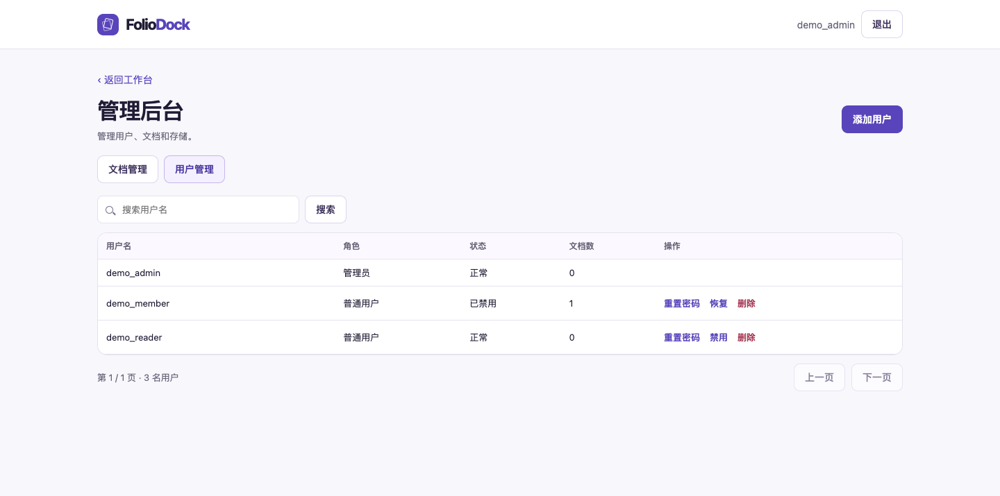

# Folio Dock

Folio Dock 是一款可自建的文档上传、在线预览和分享工具。它运行在 Cloudflare Workers，文件存放于私有 R2 存储桶，账号、文档索引和分享设置存放于 D1。

- 上传 HTML、Markdown、PDF、TXT、图片、MHTML、Excel、Word 和 PowerPoint。
- 通过链接或分享码免登录分享，可设置访问口令和有效期。关闭分享会同时撤销两个入口。
- 通过 MCP 上传文件、查询自己的文档和管理分享。
- 在后台管理用户和文档。管理员可添加普通用户、重置密码、禁用、恢复和删除账号。

## 界面截图




## 在线预览

图片支持 PNG、JPEG、GIF、WebP、AVIF、BMP 和 SVG。MHTML 显示归档中的网页、图片和样式。Excel（.xlsx）可切换工作表并查看单元格。Word（.docx）按文档版式显示页面、表格、页眉和页脚，字体和分页可能随浏览器变化。PowerPoint（.pptx）按幻灯片画布显示文字、形状和图片，动画和转场以静态画面显示。旧版 .xls、.doc、.ppt 支持上传、分享和下载。

可在线查看的文件支持「全屏预览」，包括免登录分享页。浏览器无法进入系统全屏时，预览会铺满当前页面。

网页版和 MCP 流式上传的单文件上限为 50 MB，Markdown 为 1 MB，TXT 为 2 MB（按 MiB 计）。每个账号最多存放 100 份文件，合计 150 MB。

## 本地运行

需要 Node.js 22 或更高版本。

    npm ci
    cp .dev.vars.example .dev.vars
    npm run db:local
    npm run dev

在启动前为 .dev.vars 中的 INVITE_CODE、ADMIN_SETUP_CODE 和 PASSWORD_PEPPER 各填入一个独立的随机值。可分别用 openssl rand -hex 32 生成三个值。

打开 Wrangler 显示的本地地址，用邀请码注册。在 /admin 输入管理员激活码完成首次设置。管理员可点击「添加用户」，设置用户名和至少 12 位的登录密码。后台创建的普通用户可用该账号直接登录。

在「用户管理」中可以搜索用户、重置密码、禁用、恢复和删除普通账号。重置密码会结束现有会话并撤销 MCP 令牌。禁用还会暂停该用户的文档分享，恢复后有效的分享可以继续访问。删除账号会永久移除其文档和分享。

## 部署到 Cloudflare

登录 Wrangler，创建自己的 D1 数据库和私有 R2 存储桶。以下资源名可按需替换。

    npx wrangler login
    npx wrangler d1 create my-folio-dock
    npx wrangler r2 bucket create my-folio-dock-files
    cp wrangler.jsonc wrangler.local.jsonc

在 wrangler.local.jsonc 中填写数据库名、数据库 ID 和存储桶名。若账号中多个 Worker 共享速率限制命名空间，请为本实例选择单独的 namespace_id。自定义域名可作为 Worker Custom Domain 添加到 routes。

为生产环境单独创建 .env.production，其中包含 INVITE_CODE、ADMIN_SETUP_CODE 和 PASSWORD_PEPPER。PASSWORD_PEPPER 参与现有账号及分享口令的验证，部署更新时应保留同一个值。

    npx wrangler d1 migrations apply DB --remote --config wrangler.local.jsonc
    npx wrangler deploy --config wrangler.local.jsonc --secrets-file .env.production

部署成功后，打开 Wrangler 输出的站点地址。更新版本时使用相同的私有配置，先应用数据库迁移，再执行部署。

## MCP

登录站点，在工作台选择「MCP 接入」生成令牌。客户端使用 Streamable HTTP 连接站点的 /mcp 端点，并通过 Authorization 请求头发送 Bearer 令牌。令牌只显示一次，重新生成或撤销后旧令牌会失效。

| 工具 | 用途 |
| --- | --- |
| list_documents | 列出自己的文档、可用分享链接和分享码。 |
| upload_document | 在工具参数中上传小文件，最多 4 MiB，且遵循格式上限。二进制文件使用 base64。share 默认关闭。 |
| prepare_document_upload | 按文件名和可选字节数返回流式上传地址、HTTP 方法、请求头和文件大小上限。 |
| set_document_sharing | 通过文档 ID 创建、修改或关闭分享，可设置 password 和 expires_in。 |

### 从本地路径上传并分享

使用支持本地 stdio 服务的 MCP 客户端。若尚未安装项目依赖，在仓库中运行 `npm ci`。给客户端添加以下 MCP 服务，将脚本路径替换为本机仓库的绝对路径。把站点地址和工作台生成的 MCP 令牌只保存在本机配置中。

```json
{
  "mcpServers": {
    "folio-dock-local": {
      "command": "node",
      "args": ["/absolute/path/to/folio-dock/src/mcp-local.js"],
      "env": {
        "FOLIO_SITE_URL": "https://folio.example.com",
        "FOLIO_MCP_TOKEN": "YOUR_MCP_TOKEN"
      }
    }
  }
}
```

调用 `upload_local_file` 时传入文件路径，例如：

```json
{
  "path": "/absolute/path/to/slides.pptx",
  "password": "example-passphrase",
  "expires_in": 86400
}
```

工具从本机读取文件，流式写入 R2，并返回 `share_url`、`share_code` 和文档信息。支持绝对路径和 `~/` 路径。省略 `password` 时无需口令，省略 `expires_in` 时分享不会自动过期。有效期以秒为单位，从发布时起算。文件大小限制与网页版相同。

### 流式上传

1. 调用 `prepare_document_upload`，例如传入 `{"filename":"slides.pptx","size":52428800}`。
2. 按返回的 `method`、`upload_url` 和 `headers` 发送 HTTP 请求，带上同一个 MCP Bearer 令牌，并将原文件字节作为请求体。若客户端只能调用 MCP 工具，可在终端执行以下请求。用工具返回的地址和文件名请求头替换示例变量。

```sh
curl --fail-with-body --upload-file ./slides.pptx \
  -H "Authorization: Bearer ${FOLIO_MCP_TOKEN}" \
  -H "Content-Type: application/octet-stream" \
  -H "X-Folio-Filename: ${FOLIO_UPLOAD_FILENAME}" \
  "${FOLIO_UPLOAD_URL}"
```

成功后返回 HTTP 201，文件默认私有。需要分享时，将响应中的 `document.id` 传给 `set_document_sharing`，同时传入 `enabled: true`。

expires_in 以秒为单位。修改正在生效的分享时，省略 password 或 expires_in 可保留原设置，传入 null 可移除对应限制。

## 许可证

本项目采用 [MIT 许可证](LICENSE)。依赖项使用各自的许可证。
